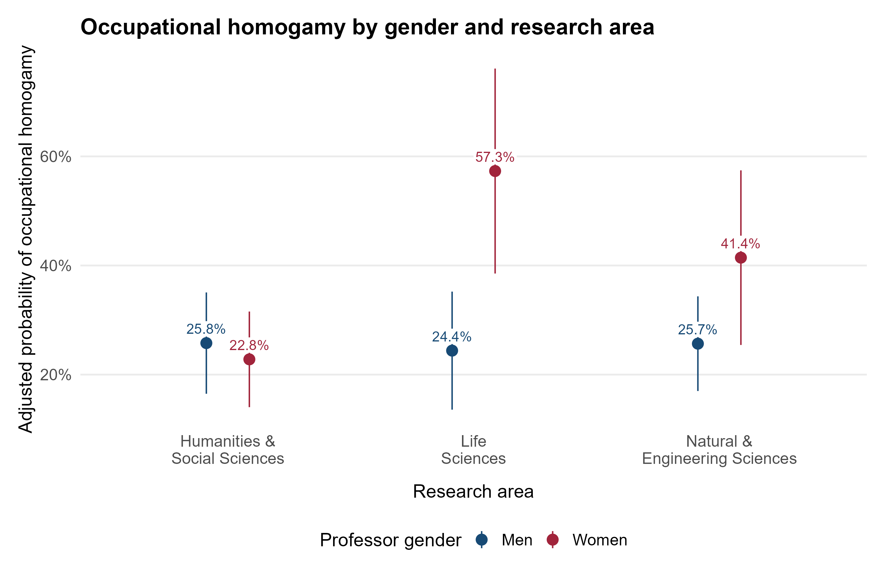
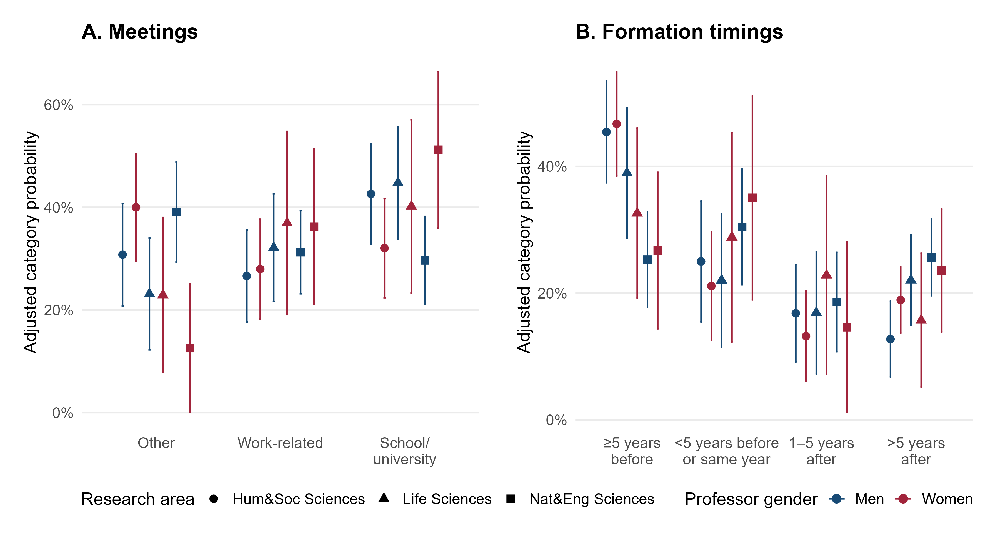
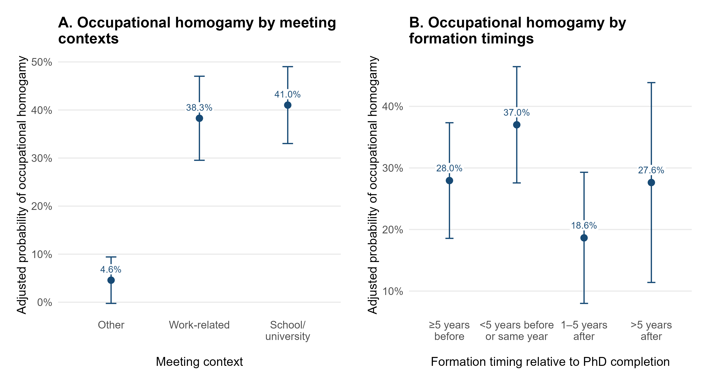
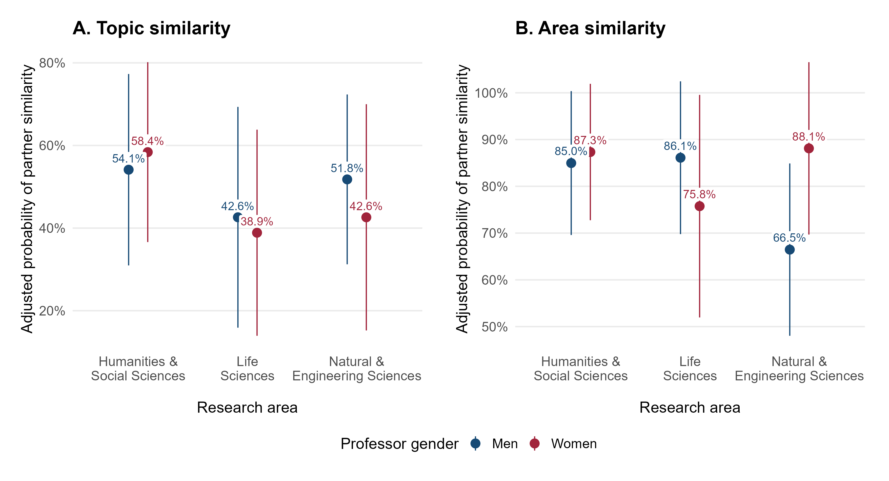
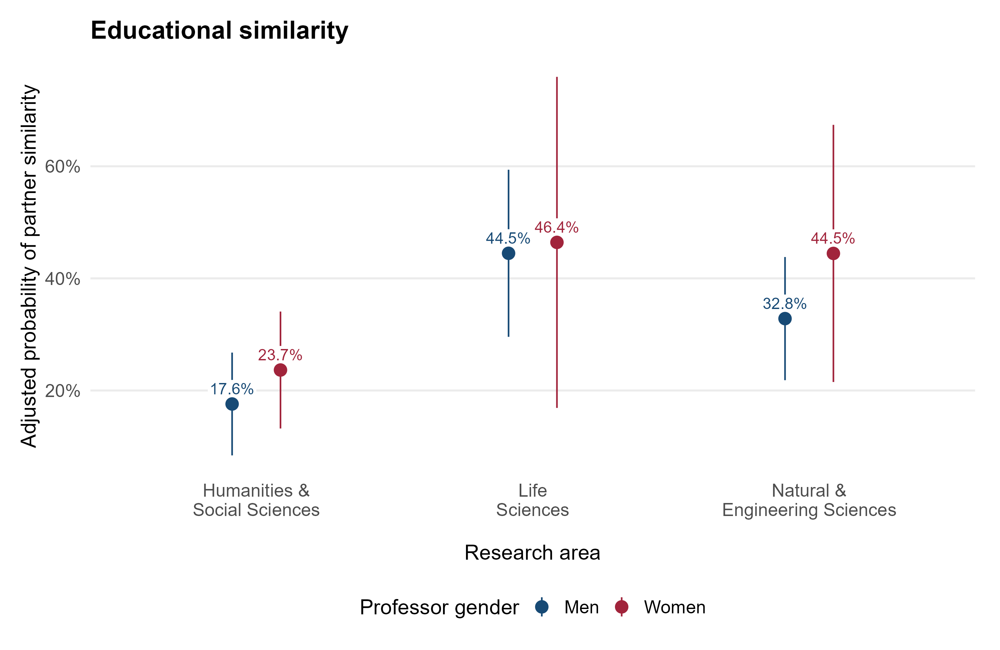

# Gender and Area Differences in Occupational Homogamy among Swiss University Professors: The Contributions of Meeting Context and Timing of Relationship Formation

# Abstract

Women academics are more likely than men to have academic partners, but this gender gap tends to be more pronounced in Natural and Engineering Sciences. We surveyed 411 professors in monogamous relationships at Swiss universities, most of whom held senior positions, to examine whether where and when couples met helped explain these differences. Contrary to expectations, the gender gap was largest in Life Sciences rather than Natural and Engineering Sciences. Women’s likelihood of having an academic partner varied across fields, whereas men’s remained comparatively stable. Meeting at school, university, or work was associated with a greater likelihood of having an academic partner. Differences in meeting context partly accounted for the larger gender gap in Natural and Engineering Sciences relative to Humanities and Social Sciences, but did not explain the corresponding Life Sciences gap. Relationship timing relative to PhD completion provided no clear additional explanation. Among professors with partners outside academia, those in Life Sciences and Natural and Engineering Sciences were more likely to have a PhD-qualified partner. Within academic couples, research-topic similarity showed no clear gender or disciplinary differences. These findings suggest that meeting circumstances help explain some disciplinary differences in academic partnering, while the largest gender gap persists beyond these circumstances. Longitudinal research is needed to distinguish partner selection from subsequent career changes.

**Keywords:** academic couples; occupational homogamy; couple formation; partner similarity; academia; university professors

**Word count (excluding abstract and references):** 7448

# Introduction

Occupational homogamy is common in academia and more frequent among women professors than among men. Previous studies have suggested that this gender difference may not be the same across research areas, but few studies have tested that variation directly. A related question is whether accounting for where and when partners met reduces these gender-by-area differences. Treating academic couples as a single phenomenon risks misdirecting dual-career and gender-equality efforts that may need to vary by discipline. This study therefore first tests whether the gender difference in current occupational homogamy among established Swiss professors depends on research area, and then estimates the interaction after adjustment for meeting context and relationship timing.

## Literature review

Surveys consistently show that women academics are more likely than men to have academic partners, although definitions and samples vary. In Switzerland, the proportion of partnered professors with academically employed partners was higher among women than men in both 2011 (43% vs. 21%; Dubach et al., 2012) and 2021 (36% vs. 22%; Liechti et al., 2022), indicating a similar pattern with a somewhat smaller gender gap in the later survey. Analysing the same 2021 dataset, Velicu et al. (2026) also reported higher rates among women across academic ranks. Comparable gender differences have been observed in North America and elsewhere in Europe. Among faculty surveyed at 13 leading U.S. universities, 40% of women and 34% of men reported having an academic partner, although this category also included partners not currently employed in academia (Schiebinger et al., 2008). Among European Research Council Advanced Grant applicants with employed partners, 65% of women and 48% of men had a partner working in science, extending this pattern to applicants to a funding scheme targeting established research leaders (Schels et al., 2024).

Gender differences also appear to vary in magnitude across disciplinary fields. Schiebinger et al. (2008, p. 29, Figure 12) found particularly large women–men gaps in occupational homogamy in engineering (43% of women vs. 26% of men), law (38% vs. 22%), and the natural sciences (48% vs. 35%). The gap was six percentage points in the social sciences (43% vs. 37%) and smaller in business (31% vs. 30%), education (32% vs. 30%), and the humanities (45% vs. 42%). Using the same 2006–2007 U.S. survey, Juraqulova et al. (2015, p. 377, Table 2) reported a larger gap among married or cohabiting faculty in STEM (49% vs. 26%) than in non-STEM fields (40% vs. 26%). Also analyzing this survey, Girod et al. (2011) found a gap of approximately 11 percentage points among academic surgeons (40% vs. 29.3%). The Swiss surveys provide complementary evidence using a different indicator of dual-career partnerships, which can include partners working outside academia. Among partnered staff with doctorates and professors combined, Dubach et al. (2012, p. 164, Figure 64) reported larger gender gaps in Technical Sciences (69% vs. 33%) and Exact and Natural Sciences (70% vs. 42%) than in Humanities and Social Sciences (56% vs. 39%). Liechti et al. (2022, p. 14) similarly reported a larger gap in Technical Sciences (67% vs. 34%) than in Humanities and Social Sciences (43% vs. 38%) among staff with doctorates, including assistant professors. Their dual-career analyses retained single respondents in the denominator, so these percentages are not directly comparable with Dubach’s partnered-only estimates. Together, these descriptive findings suggest disciplinary variation in gender differences in academic and dual-career partnerships, with some of the largest gaps observed in STEM and other traditionally male-dominated fields.

However, these findings provide limited evidence that research area moderates gender differences in academic occupational homogamy among established professors. Previous studies generally report separate percentages for women and men rather than testing a gender-by-field interaction, and estimates from a single discipline cannot identify between-field differences. Samples also mix academic ranks and career stages, use different denominators, and operationalize partnerships differently. For example, the reports by Dubach et al. (2012) and Liechti et al. (2022) defined dual-career partnerships through both partners’ substantial employment commitments and the partner’s qualification at master’s level or above, regardless of employment sector. Liechti et al. (2022) also separately identified partners employed in academia and distinguished professors from other academic staff with or without a PhD. Velicu et al. (2026), by comparison, simply classified participants as homogamous when they answered “yes” to “Does your partner work in academia, too?” The question that remains is whether the size of the gender difference varies across research areas among established professors.

Gender differences in occupational homogamy may vary across research areas because disciplinary environments provide women and men with different opportunities to meet academic partners. Versluys et al. (2021) distinguish three mechanisms underlying partner similarity: mate choice (involving preferences for similarity or shared preferences for desirable characteristics such as intelligence or status); convergence over time; and stratification, whereby structured social environments bring similar individuals into contact. The latter mechanism suggests that occupational homogamy can arise partly because educational and professional environments concentrate encounters among people with similar backgrounds and career trajectories. Couples formed in educational settings are often educationally homogamous, but this similarity does not necessarily translate into similar subsequent occupations (Bouchet-Valat & Grobon, 2019). Research areas may contribute to this process through specialized training and links between fields of study and occupational destinations (Andrade & Thomsen, 2019; DiPrete et al., 2017; Han & Qian, 2024; Roksa & Levey, 2010).

The relevance of disciplinary environments to partner formation may also depend on when a relationship begins. Before entering doctoral training, future academics may meet partners through schools, undergraduate studies, or social networks that include people pursuing diverse occupational paths. During doctoral training and subsequent academic employment, professional networks may provide greater exposure to other researchers, making academic partnering more likely when relationships develop through these networks. This expectation is consistent with evidence linking shared workplaces to similarity in achieved social class (Kalmijn & Flap, 2001) and with the argument that later partnership formation can increase the relevance of workplaces and occupational characteristics to partner selection (Schwartz et al., 2021). Gender differences in relationship timing could therefore produce differences in exposure to potential academic partners. For example, Hill’s (2020) interviews with doctoral students found that women more often described deliberately postponing romantic relationships to prioritize career goals.

However, the timing of formation of romantic relationships, and the opportunities to meet a different-gender academic partner, may also depend on the gender composition of these environments. Where men substantially outnumber women, women have a larger pool of potential male academic partners relative to the pool of potential female academic partners available to men. Among Swiss full professors in 2024, women represented 37% in Humanities and Social Sciences but 15% in Exact and Natural Sciences (swissuniversities, 2025, p. 3). These current full-professor percentages do not measure the partner pools available when relationships formed. Demographic imbalance has nevertheless been proposed as an explanation for women’s higher rates of academic partnering (Astin & Milem, 1997; Schiebinger et al., 2008; Sonnert, 1995), especially in male-typical fields. For example, among academic couples in Schiebinger et al.’s study (2008, Figure 13), women–men differences in sharing a research field were larger in Natural Sciences (83% of women vs. 54% of men), Engineering (64% vs. 25%), and business (48% vs. 28%) than in Social Sciences (59% vs. 58%). In humanities (70% vs. 78%), medicine (68% vs. 70%), and particularly in education (36% vs. 55%), the pattern was reversed, with higher percentages among men. These findings concern disciplinary similarity within existing academic couples; they do not independently establish differences in the probability of having an academic partner. Law also showed a substantial women–men difference (79% vs. 38%), although the small subgroup warrants caution. In the Swiss context, Osterloh and Rost (2026, Figure 10b) similarly showed that women academics in male-dominated fields were more likely to have met their partner within their field of study than women in female-dominated fields.

These considerations suggest that understanding gender-by-area differences in occupational homogamy requires examining both the settings in which partners meet and the stage of academic training at which their relationships begin, and how these circumstances differ by gender and research area.

## The Current Study

The present study examines gender and research-area differences in occupational homogamy among currently partnered, predominantly senior professors in monogamous, different-gender relationships at Swiss universities. We define occupational homogamy as having a current partner who pursues an academic career or has previously attained at least the rank of lecturer or assistant professor. We first test whether gender differences in occupational homogamy vary across Humanities and Social Sciences, Life Sciences, and Natural and Engineering Sciences. We then examine whether meeting context and relationship timing are associated with occupational homogamy and help account statistically for these differences.

**Gender differences across research areas (H1).** Our first hypothesis builds on previous empirical findings. Analyses of a U.S. faculty survey reported larger gender gaps in academic partnering in STEM than in non-STEM fields, with particularly pronounced differences in engineering and the natural sciences (Juraqulova et al., 2015; Schiebinger et al., 2008). Swiss surveys provide complementary, indirect evidence: gender gaps in dual-career partnerships were larger in technical and natural sciences than in humanities and social sciences, although this indicator also includes partners working outside academia (Dubach et al., 2012; Liechti et al., 2022). Extending these findings to our research-area classification, we hypothesize that the women–men difference in the probability of occupational homogamy is larger in Life Sciences, and particularly in Natural and Engineering Sciences, than in Humanities and Social Sciences (H1).

**Meeting context (H2a).** Where partners meet may help account for these differences. Previous research links meeting in educational settings to educational homogamy and shared workplaces to similarity in achieved social class (Bouchet-Valat & Grobon, 2019; Kalmijn & Flap, 2001). These findings suggest that opportunities for contact within educational and occupational environments may also contribute to academic partnering. Furthermore, a Swiss survey composed predominantly of students and junior academics found that women in male-dominated study fields were more likely to have met their partner within university, especially in their field of study, compared to women in female-dominated fields (Osterloh & Rost, 2026). We therefore expect meeting at school, university, or work to be associated with a higher probability of occupational homogamy than meeting elsewhere. We hypothesize that accounting for meeting context reduces the differences between field-specific gender gaps, particularly the Natural and Engineering Sciences–Humanities and Social Sciences contrast (H2a).

**Relationship timing (H2b).** When relationships begin may also matter. Doctoral training and subsequent academic employment may increase opportunities to meet other researchers as individuals become more embedded in academic environments. Relationships formed at these stages may therefore be more likely to involve two academics. We expect a higher probability of occupational homogamy when relationships began closer to or after PhD completion than at least five years earlier; the data do not identify doctoral enrolment dates. We hypothesize that accounting for relationship-formation timing reduces the differences between field-specific gender gaps, particularly the Natural and Engineering Sciences–Humanities and Social Sciences contrast (H2b).

All primary analyses adjust for participant age, partner-age similarity, and relationship duration. We assess the associations of meeting context and timing with occupational homogamy, their distributions across gender and research area, and changes in gender-gap contrasts after adjustment. These analyses concern statistical associations and attenuation rather than causal mediation. Finally, we explore partner educational qualifications among non-academic couples and research-topic and research-area similarity among academic couples.

# Methods

## Sample, sample selection, and procedure

The survey targeted professors affiliated with Swiss higher education institutions, which comprise universities and institutes of technology, universities of applied sciences and arts, and universities of teacher education.

In March 2025, we compiled a database of more than 9,000 professors’ email addresses by scraping publicly available university directories. The recruitment frame covered all three sectors: approximately 71% of addresses came from universities and institutes of technology, 24% from universities of applied sciences, and 5% from universities of teacher education. This distribution was close to the national staff distribution (Federal Statistical Office [FSO], 2024). Institution type was not recorded for individual respondents.

Potential participants received an email invitation describing the study and linking to the questionnaire. Data were collected online in French and English between June and July 2025 using REDCap. Participation was voluntary and anonymous, and all respondents provided informed consent. The questionnaire covered academic careers, sociodemographic characteristics, relationship histories, and cultural influences, and took approximately 15 minutes to complete. Ethical approval was granted by the Ethics Committee of [anonymized university name] ([anonymized application number]).

We collected 708 individual responses from 9,015 invitations (response rate = 7.85%). Because recruitment may have reached individuals outside the target population, including teaching-only and research staff without professorial appointments, eligibility was reassessed after data collection. We excluded respondents with missing highest academic rank (n = 72), those whose highest rank was PhD candidate/graduate (n = 29) or postdoctoral fellow/assistant lecturer (n = 15), and those who did not report a valid PhD/doctoral completion year (n = 48), leaving 544 eligible participants.

The analytic sample was restricted to participants reporting one partner in a monogamous relationship. We excluded single/other and missing-status responses (n = 76), participants reporting multiple partners (n = 20), those with insufficient information to classify their partner’s academic status (n = 13), and those with missing main research area (n = 1). Gender comparisons were restricted to cisgender participants, defined as men reporting male sex at birth and women reporting female sex at birth; participants with missing or discordant responses were excluded (n = 6). We also excluded same-gender relationships and relationships with unknown partner gender (n = 17). The analytic sample comprised 411 cisgender professors currently in monogamous, different-gender relationships, including 161 women (39.2%) and 250 men. Comparisons with the national professoriate are provided in Supplementary section 1.

## Measures

Participants reported their sex at birth, gender, partner’s gender, age, academic career, current relationship, and demographic background. Main research area was reported using four categories: Humanities & Social Sciences, Life Sciences, Natural Sciences, and Engineering. This classification has been used by the German Research Foundation and broadly overlaps with the Swiss National Science Foundation’s three-area classification, while distinguishing Natural Sciences from Engineering. We combined Natural and Engineering Sciences because few women were represented in Engineering, yielding three research-area groups.

Current occupational homogamy was coded 1 when the current partner worked as an academic research scientist (e.g., PhD student, postdoctoral researcher, lecturer/assistant professor, professor, or dean/director) or had previously attained at least lecturer/assistant-professor rank; other partners were coded 0. This definition includes partners who subsequently left academia and therefore does not require both partners to be currently employed in academia. Although the questionnaire collected partner information from participants in polyamorous or open relationships, these participants were excluded from the present analyses.

Three separate exploratory outcomes assessed partner education, research-topic similarity, and research-area similarity. Partner education distinguished PhD-qualified from non-PhD-qualified partners within non-academic couples; because all participants held a PhD, this indicated educational homogamy. Within academic couples, topic similarity distinguished same/similar from different research topics, while area similarity distinguished the same from different research areas. Same-area partnerships included both same/similar topics and different topics within the same area.

Meeting context was assessed with “How did you meet your partner?” and eight response options: at university as an undergraduate; at university as a graduate or PhD student; while working at the same university or research institution; in a science-related social setting (e.g., a conference); through mutual academic contacts; through mutual non-academic friends or family; while working in a non-academic job; and other (specify). Responses, including open-text answers, were grouped into three categories. School/university included meetings as students at school, college, or university. Work-related settings included university/research-institution employment, science-related events, mutual academic contacts, and non-academic employment. Other settings included friends/family, hobbies/leisure, online/dating, and other contexts.

Relationship-formation timing was calculated as the relationship-start year minus the PhD-completion year and grouped into four categories: five or more years before completion, less than five years before or the completion year, one to five years after, and more than five years after. These categories refer to PhD completion rather than documented doctoral enrolment. Covariates were participant age, relationship duration, and partner-age similarity (an absolute age difference of 0–2 versus at least 3 years). Age and relationship duration were mean-centered. Table 1 reports signed age difference (partner age minus participant age); bivariate analyses used absolute partner age difference and continuous formation timing.

## Statistical analysis

Our analyses addressed two main questions. First, we examined whether gender differences in occupational homogamy varied across research areas (H1). Second, we examined whether accounting for meeting context and relationship-formation timing reduced the differences between field-specific gender gaps (H2a and H2b, respectively). We also conducted exploratory analyses of other forms of partner similarity. Primary adjusted models included participant age, partner-age similarity, and relationship duration; sensitivity models also examined omission of these covariates. Analyses were conducted in R (R Core Team, 2025); the R and package versions used are recorded with the analysis outputs.

**Gender differences across research areas (H1).** We estimated a linear probability model (Model 1) including gender, research area, and their interaction. Linear probability models express differences in the probability of having an academic partner directly in percentage points. Gender was effect-coded (women = +0.5; men = −0.5). We estimated adjusted probabilities for women and men in each research area and compared the resulting gender gaps. Primary tests comprised the overall women–men contrast and the two contrasts comparing the gender gaps in Life Sciences and Natural and Engineering Sciences with that in Humanities and Social Sciences. We also reported the overall gender-by-research-area interaction and supporting within-field gender comparisons.

**Meeting context and relationship timing (H2a and H2b).** We examined whether accounting for meeting context and relationship-formation timing reduced the differences between field-specific gender gaps. Models 2–3 jointly predicted the meeting-context and formation-timing category indicators from gender × research area and the baseline covariates. We extended the occupational-homogamy baseline model by adding meeting context (Model 4) and, separately, relationship timing (Model 5). The reference categories were other meeting contexts and at least five years before PhD completion. We examined how these circumstances were associated with occupational homogamy and whether their distributions differed by gender and research area. We then quantified reductions in field-gap contrasts using indirect associations (Models 6–7), with HC3 delta-method variances and Rubin pooling. Each H2 family comprised two indirect contrasts, comparing Life Sciences and Natural and Engineering Sciences with Humanities and Social Sciences; all four were estimated regardless of omnibus significance. Because the data are observational and cross-sectional, these analyses concern statistical associations rather than causal mediation (Weems, 2025).

**Exploratory analyses.** We examined educational similarity among professors with non-academic partners (Model 14), and research-topic and research-area similarity among professors with academic partners (Models 8–9), using the same baseline predictors as Model 1. Missing subgroup outcomes and structural inapplicability were not imputed. Supporting extensions adding meeting context or timing and continuous-timing specifications are reported in the Supplement.

**Missing data and statistical inference.** Missing values in the analysis variables were addressed using multiple imputation by chained equations with the mice package (van Buuren & Groothuis-Oudshoorn, 2011), generating 50 datasets under a missing-at-random assumption conditional on the imputation variables. Imputation used methods appropriate to variable type and retained gender-by-research-area heterogeneity. Estimates and their variances were combined using Rubin’s rules (Rubin, 1987). We used HC3 heteroskedasticity-consistent covariance estimates (MacKinnon & White, 1985), implemented with sandwich (Zeileis, 2004), to account for nonconstant residual variance. HC3 does not account for possible dependence between participating partners. Tests were two-sided, with pointwise 95% confidence intervals. Holm correction applied within the two H1 field-gap contrasts and separately within each two-contrast H2 family; support also required the predicted direction. The overall gender contrast and supporting within-field tests were unadjusted. Supporting pairwise comparisons among the six gender-by-area groups and among meeting contexts used Tukey adjustment. Exploratory Holm families comprised the three interaction tests, the three within-field gender contrasts for each outcome, and the two partner-education field contrasts. Full specifications, supporting tests, and coefficient estimates are provided in Supplementary Tables S3, S5, and S6.

**Robustness checks.** We compared the findings with complete-case analyses, logistic occupational-homogamy models, and models excluding observations flagged by the residual, Cook’s-distance, and leverage criteria described in the Supplement. We also omitted all baseline covariates and re-estimated timing-related models without relationship duration. Additional checks replaced categorical timing with continuous linear, quadratic, and cubic terms in the occupational-homogamy model and recalculated the corresponding indirect associations. Category-distribution Models 2–3 underwent complete-case, exclusion, and covariate-omission checks; logistic and polynomial outcome specifications concerned occupational homogamy. Detailed diagnostics and sensitivity results are reported in Supplementary Table S4 and Figures S2–S4 and S7.

# Results

## 1. Sample Characteristics and Descriptive Statistics

The analytic sample comprised 411 cisgender professors (161 women; 250 men) affiliated with Swiss universities who were currently in heterosexual, monogamous, romantic relationships. Participants’ mean age was 49.5 years (SD = 9.0), and 70.1% had attained the rank of (full) professor/director of research or dean/institute director. The remaining participants reported having attained the rank of Lecturer/Assistant Professor (15.6%) or Senior Lecturer/Associate Professor (14.4%). It included 181 in Humanities & Social Sciences (50.8% women), 91 in Life Sciences (34.1% women), 139 in Natural & Engineering Sciences (27.3% women).

Compared with the national professoriate (Supplementary section 1), women were slightly overrepresented overall (women represented 30.8% of the national professoriate, compared with 39.2% of this sample), particularly in Humanities & Social Sciences (women represented 43.4% of the national Humanities & Social Sciences area vs. 50.8% in this sample). However, our area classifications are not directly equivalent to the national classification (Supplementary section 1).

Table 1 provides the study variables, by gender. Supplementary section 1 provides further demographics of participants and their partners. Missing responses occurred for meeting context (16; 3.9%), formation timing (18; 4.4%), age (36; 8.8%), age similarity (50; 12.2%), relationship duration (18; 4.4%).

**Table 1. Demographics and study variables by gender**

<table>
 <thead>
  <tr>
   <th style="text-align:left;"> Variable </th>
   <th style="text-align:left;"> Category </th>
   <th style="text-align:left;"> Men </th>
   <th style="text-align:left;"> Women </th>
   <th style="text-align:left;"> Total </th>
   <th style="text-align:left;"> Missing n (%) </th>
  </tr>
 </thead>
<tbody>
  <tr>
   <td style="text-align:left;"> Age, years </td>
   <td style="text-align:left;"> M (SD) </td>
   <td style="text-align:left;"> 51.1 (9.0) </td>
   <td style="text-align:left;"> 46.9 (8.3) </td>
   <td style="text-align:left;"> 49.5 (9.0) </td>
   <td style="text-align:left;"> 36 (8.8%) </td>
  </tr>
  <tr>
   <td style="text-align:left;"> Age at PhD completion, years </td>
   <td style="text-align:left;"> M (SD) </td>
   <td style="text-align:left;"> 30.6 (4.1) </td>
   <td style="text-align:left;"> 31.5 (4.7) </td>
   <td style="text-align:left;"> 30.9 (4.4) </td>
   <td style="text-align:left;"> 36 (8.8%) </td>
  </tr>
  <tr>
   <td style="text-align:left;"> Age at relationship formation, years </td>
   <td style="text-align:left;"> M (SD) </td>
   <td style="text-align:left;"> 30.2 (8.9) </td>
   <td style="text-align:left;"> 28.8 (7.7) </td>
   <td style="text-align:left;"> 29.7 (8.5) </td>
   <td style="text-align:left;"> 53 (12.9%) </td>
  </tr>
  <tr>
   <td style="text-align:left;"> Relationship duration, years </td>
   <td style="text-align:left;"> M (SD) </td>
   <td style="text-align:left;"> 21.4 (11.0) </td>
   <td style="text-align:left;"> 18.7 (10.4) </td>
   <td style="text-align:left;"> 20.3 (10.9) </td>
   <td style="text-align:left;"> 18 (4.4%) </td>
  </tr>
  <tr>
   <td style="text-align:left;"> Formation timing relative to PhD completion, years </td>
   <td style="text-align:left;"> M (SD) </td>
   <td style="text-align:left;"> -0.6 (9.3) </td>
   <td style="text-align:left;"> -2.4 (9.1) </td>
   <td style="text-align:left;"> -1.3 (9.2) </td>
   <td style="text-align:left;"> 18 (4.4%) </td>
  </tr>
  <tr>
   <td style="text-align:left;"> Partner minus professor age, years </td>
   <td style="text-align:left;"> M (SD) </td>
   <td style="text-align:left;"> -2.6 (5.0) </td>
   <td style="text-align:left;"> 2.4 (5.1) </td>
   <td style="text-align:left;"> -0.7 (5.6) </td>
   <td style="text-align:left;"> 50 (12.2%) </td>
  </tr>
  <tr>
   <td style="text-align:left;"> Research area </td>
   <td style="text-align:left;">  </td>
   <td style="text-align:left;"> 250 observed </td>
   <td style="text-align:left;"> 161 observed </td>
   <td style="text-align:left;"> 411 observed </td>
   <td style="text-align:left;"> 0 (0.0%) </td>
  </tr>
  <tr>
   <td style="text-align:left;">  </td>
   <td style="text-align:left;"> Hum&amp;Soc Sciences </td>
   <td style="text-align:left;"> 89 (35.6%) </td>
   <td style="text-align:left;"> 92 (57.1%) </td>
   <td style="text-align:left;"> 181 (44.0%) </td>
   <td style="text-align:left;">  </td>
  </tr>
  <tr>
   <td style="text-align:left;">  </td>
   <td style="text-align:left;"> Life Sciences </td>
   <td style="text-align:left;"> 60 (24.0%) </td>
   <td style="text-align:left;"> 31 (19.3%) </td>
   <td style="text-align:left;"> 91 (22.1%) </td>
   <td style="text-align:left;">  </td>
  </tr>
  <tr>
   <td style="text-align:left;">  </td>
   <td style="text-align:left;"> Nat&amp;Eng Sciences </td>
   <td style="text-align:left;"> 101 (40.4%) </td>
   <td style="text-align:left;"> 38 (23.6%) </td>
   <td style="text-align:left;"> 139 (33.8%) </td>
   <td style="text-align:left;">  </td>
  </tr>
  <tr>
   <td style="text-align:left;"> Highest academic rank attained </td>
   <td style="text-align:left;">  </td>
   <td style="text-align:left;"> 250 observed </td>
   <td style="text-align:left;"> 161 observed </td>
   <td style="text-align:left;"> 411 observed </td>
   <td style="text-align:left;"> 0 (0.0%) </td>
  </tr>
  <tr>
   <td style="text-align:left;">  </td>
   <td style="text-align:left;"> Lecturer / Assistant professor </td>
   <td style="text-align:left;"> 25 (10.0%) </td>
   <td style="text-align:left;"> 39 (24.2%) </td>
   <td style="text-align:left;"> 64 (15.6%) </td>
   <td style="text-align:left;">  </td>
  </tr>
  <tr>
   <td style="text-align:left;">  </td>
   <td style="text-align:left;"> Senior lecturer / Associate professor </td>
   <td style="text-align:left;"> 40 (16.0%) </td>
   <td style="text-align:left;"> 19 (11.8%) </td>
   <td style="text-align:left;"> 59 (14.4%) </td>
   <td style="text-align:left;">  </td>
  </tr>
  <tr>
   <td style="text-align:left;">  </td>
   <td style="text-align:left;"> Professor / Director of research </td>
   <td style="text-align:left;"> 141 (56.4%) </td>
   <td style="text-align:left;"> 85 (52.8%) </td>
   <td style="text-align:left;"> 226 (55.0%) </td>
   <td style="text-align:left;">  </td>
  </tr>
  <tr>
   <td style="text-align:left;">  </td>
   <td style="text-align:left;"> Dean / Institute Director </td>
   <td style="text-align:left;"> 44 (17.6%) </td>
   <td style="text-align:left;"> 18 (11.2%) </td>
   <td style="text-align:left;"> 62 (15.1%) </td>
   <td style="text-align:left;">  </td>
  </tr>
  <tr>
   <td style="text-align:left;"> Partner-age similarity </td>
   <td style="text-align:left;">  </td>
   <td style="text-align:left;"> 223 observed </td>
   <td style="text-align:left;"> 138 observed </td>
   <td style="text-align:left;"> 361 observed </td>
   <td style="text-align:left;"> 50 (12.2%) </td>
  </tr>
  <tr>
   <td style="text-align:left;">  </td>
   <td style="text-align:left;"> 3+ years </td>
   <td style="text-align:left;"> 107 (48.0%) </td>
   <td style="text-align:left;"> 80 (58.0%) </td>
   <td style="text-align:left;"> 187 (51.8%) </td>
   <td style="text-align:left;">  </td>
  </tr>
  <tr>
   <td style="text-align:left;">  </td>
   <td style="text-align:left;"> 0-2 years </td>
   <td style="text-align:left;"> 116 (52.0%) </td>
   <td style="text-align:left;"> 58 (42.0%) </td>
   <td style="text-align:left;"> 174 (48.2%) </td>
   <td style="text-align:left;">  </td>
  </tr>
  <tr>
   <td style="text-align:left;"> Meeting context </td>
   <td style="text-align:left;">  </td>
   <td style="text-align:left;"> 240 observed </td>
   <td style="text-align:left;"> 155 observed </td>
   <td style="text-align:left;"> 395 observed </td>
   <td style="text-align:left;"> 16 (3.9%) </td>
  </tr>
  <tr>
   <td style="text-align:left;">  </td>
   <td style="text-align:left;"> Other </td>
   <td style="text-align:left;"> 75 (31.2%) </td>
   <td style="text-align:left;"> 49 (31.6%) </td>
   <td style="text-align:left;"> 124 (31.4%) </td>
   <td style="text-align:left;">  </td>
  </tr>
  <tr>
   <td style="text-align:left;">  </td>
   <td style="text-align:left;"> At work or in work-related contexts </td>
   <td style="text-align:left;"> 74 (30.8%) </td>
   <td style="text-align:left;"> 46 (29.7%) </td>
   <td style="text-align:left;"> 120 (30.4%) </td>
   <td style="text-align:left;">  </td>
  </tr>
  <tr>
   <td style="text-align:left;">  </td>
   <td style="text-align:left;"> At School/University as students </td>
   <td style="text-align:left;"> 91 (37.9%) </td>
   <td style="text-align:left;"> 60 (38.7%) </td>
   <td style="text-align:left;"> 151 (38.2%) </td>
   <td style="text-align:left;">  </td>
  </tr>
  <tr>
   <td style="text-align:left;"> Formation timing category </td>
   <td style="text-align:left;">  </td>
   <td style="text-align:left;"> 239 observed </td>
   <td style="text-align:left;"> 154 observed </td>
   <td style="text-align:left;"> 393 observed </td>
   <td style="text-align:left;"> 18 (4.4%) </td>
  </tr>
  <tr>
   <td style="text-align:left;">  </td>
   <td style="text-align:left;"> 5 years or more before PhD completion year </td>
   <td style="text-align:left;"> 86 (36.0%) </td>
   <td style="text-align:left;"> 61 (39.6%) </td>
   <td style="text-align:left;"> 147 (37.4%) </td>
   <td style="text-align:left;">  </td>
  </tr>
  <tr>
   <td style="text-align:left;">  </td>
   <td style="text-align:left;"> Less than 5 years before or during PhD completion year </td>
   <td style="text-align:left;"> 61 (25.5%) </td>
   <td style="text-align:left;"> 43 (27.9%) </td>
   <td style="text-align:left;"> 104 (26.5%) </td>
   <td style="text-align:left;">  </td>
  </tr>
  <tr>
   <td style="text-align:left;">  </td>
   <td style="text-align:left;"> 1 to 5 years after PhD completion year </td>
   <td style="text-align:left;"> 41 (17.2%) </td>
   <td style="text-align:left;"> 25 (16.2%) </td>
   <td style="text-align:left;"> 66 (16.8%) </td>
   <td style="text-align:left;">  </td>
  </tr>
  <tr>
   <td style="text-align:left;">  </td>
   <td style="text-align:left;"> More than 5 years after PhD completion year </td>
   <td style="text-align:left;"> 51 (21.3%) </td>
   <td style="text-align:left;"> 25 (16.2%) </td>
   <td style="text-align:left;"> 76 (19.3%) </td>
   <td style="text-align:left;">  </td>
  </tr>
  <tr>
   <td style="text-align:left;"> Current occupational homogamy </td>
   <td style="text-align:left;">  </td>
   <td style="text-align:left;"> 250 observed </td>
   <td style="text-align:left;"> 161 observed </td>
   <td style="text-align:left;"> 411 observed </td>
   <td style="text-align:left;"> 0 (0.0%) </td>
  </tr>
  <tr>
   <td style="text-align:left;">  </td>
   <td style="text-align:left;"> Non-academic couple </td>
   <td style="text-align:left;"> 189 (75.6%) </td>
   <td style="text-align:left;"> 104 (64.6%) </td>
   <td style="text-align:left;"> 293 (71.3%) </td>
   <td style="text-align:left;">  </td>
  </tr>
  <tr>
   <td style="text-align:left;">  </td>
   <td style="text-align:left;"> Academic couple </td>
   <td style="text-align:left;"> 61 (24.4%) </td>
   <td style="text-align:left;"> 57 (35.4%) </td>
   <td style="text-align:left;"> 118 (28.7%) </td>
   <td style="text-align:left;">  </td>
  </tr>
  <tr>
   <td style="text-align:left;"> Partner education within non-academic couples </td>
   <td style="text-align:left;">  </td>
   <td style="text-align:left;"> 189 observed </td>
   <td style="text-align:left;"> 103 observed </td>
   <td style="text-align:left;"> 292 observed </td>
   <td style="text-align:left;"> 1 (0.3%) </td>
  </tr>
  <tr>
   <td style="text-align:left;">  </td>
   <td style="text-align:left;"> Partner has no doctorate </td>
   <td style="text-align:left;"> 131 (69.3%) </td>
   <td style="text-align:left;"> 72 (69.9%) </td>
   <td style="text-align:left;"> 203 (69.5%) </td>
   <td style="text-align:left;">  </td>
  </tr>
  <tr>
   <td style="text-align:left;">  </td>
   <td style="text-align:left;"> Partner has a doctorate </td>
   <td style="text-align:left;"> 58 (30.7%) </td>
   <td style="text-align:left;"> 31 (30.1%) </td>
   <td style="text-align:left;"> 89 (30.5%) </td>
   <td style="text-align:left;">  </td>
  </tr>
  <tr>
   <td style="text-align:left;"> Partner research topics within academic couples </td>
   <td style="text-align:left;">  </td>
   <td style="text-align:left;"> 61 observed </td>
   <td style="text-align:left;"> 57 observed </td>
   <td style="text-align:left;"> 118 observed </td>
   <td style="text-align:left;"> 0 (0.0%) </td>
  </tr>
  <tr>
   <td style="text-align:left;">  </td>
   <td style="text-align:left;"> Same/similar topics(s) </td>
   <td style="text-align:left;"> 31 (50.8%) </td>
   <td style="text-align:left;"> 27 (47.4%) </td>
   <td style="text-align:left;"> 58 (49.2%) </td>
   <td style="text-align:left;">  </td>
  </tr>
  <tr>
   <td style="text-align:left;">  </td>
   <td style="text-align:left;"> Different topics in same area </td>
   <td style="text-align:left;"> 17 (27.9%) </td>
   <td style="text-align:left;"> 20 (35.1%) </td>
   <td style="text-align:left;"> 37 (31.4%) </td>
   <td style="text-align:left;">  </td>
  </tr>
  <tr>
   <td style="text-align:left;">  </td>
   <td style="text-align:left;"> Different areas </td>
   <td style="text-align:left;"> 13 (21.3%) </td>
   <td style="text-align:left;"> 10 (17.5%) </td>
   <td style="text-align:left;"> 23 (19.5%) </td>
   <td style="text-align:left;">  </td>
  </tr>
</tbody>
</table>

Note. Observed values, without imputation: continuous variables are M (SD); categorical values are n (%) among observed eligible responses. Men: n = 250; women: n = 161; total N = 411. Missing values appear as n (%) in one cell on each variable heading; percentages are based on all eligible participants. Signed age difference is partner age minus professor age: positive values indicate an older partner and negative values a younger partner. Partner-education and topic denominators are restricted to non-academic and academic couples, respectively. Structural inapplicability is excluded.

## 2. Gender Differences in Occupational Homogamy Across Research Areas (H1)

Overall, 118 professors (28.7%) were classified as being in an academic couple (35.4% of women, 24.4% of men; Table 1). These included professors whose partners currently pursued academic careers or had attained at least lecturer/assistant-professor rank before leaving academia (Supplementary section 1).

**We predicted that the women–men difference in the probability of occupational homogamy is larger in Life Sciences, and particularly in Natural and Engineering Sciences, compared with Humanities and Social Sciences (H1).** Adjusting for age, partner-age similarity and relationship length, Model 1 examined the interaction between professors’ gender/sex and their research area in predicting occupational homogamy. The omnibus effect for the gender-by-area interaction was statistically significant (F(2, 400.01) = 4.35, p = .013). Occupational-homogamy adjusted probabilities were 57.3% vs. 24.4%, p = .003 in Life Sciences, 41.4% vs. 25.7%, p = .091 in Natural & Engineering Sciences, and 22.8% vs. 25.8%, p = .649 in Humanities & Social Sciences (women vs. men). The corresponding women–men differences across areas were +32.9 percentage points in Life Sciences, +15.8 percentage points in Nat&Eng Sciences, and -3.0 percentage points in Hum&Soc Sciences, respectively. Thus, the differences in gender gaps relative to Humanities & Social Sciences were 35.9 percentage points for Life Sciences (Holm-adjusted p = .010) and 18.7 percentage points for Nat&Eng Sciences (Holm-adjusted p = .098), respectively. These results are visible in Figure 1 and Supplementary Table S6. Supplementary Table S3 displays all 15 pairwise comparisons of these different groups.

Figure 1. Adjusted occupational-homogamy probabilities by professor gender and research area. Models adjust for participant age, partner-age similarity and relationship duration. Labels above the points show each group’s adjusted probability as a percentage. Points and pointwise HC3/Rubin-pooled 95% CIs are not clipped.

## 3. Meeting Context and Relationship Timing (H2a and H2b)

We hypothesized that **accounting for meeting context (H2a) and relationship-formation timing (H2b) reduces the differences between field-specific gender gaps**, particularly the Natural and Engineering Sciences–Humanities and Social Sciences contrast.

We first tested whether **meeting circumstances and formation timings of professors’ romantic relationships differed by gender and research area (Models 2–3).** Adjusting for the same baseline covariates (age, partner-age similarity and duration), the gender-by-area interaction in meeting contexts (Model 2) was statistically significant (F(4, 399.40) = 3.39, p = .010). In Natural & Engineering Sciences, the adjusted probability of meeting outside school or work-related contexts was 12.6% for women versus 39.1% for men (p = .001). In Life Sciences, the adjusted probability of meeting outside school or work-related contexts was 22.9% for women versus 23.1% for men (p = .982). In Humanities & Social Sciences, the adjusted probability of meeting outside school or work-related contexts was 40.0% for women versus 30.8% for men (p = .215). As seen in Figure 2, differences in the men–women gaps in meeting in Other contexts, comparing Natural & Engineering Sciences with Life Sciences and Humanities & Social Sciences, were 26.3 (p = .033) and 35.7 (p < .001) percentage points, respectively.

Adjusting for the same covariates, the research-area association with formation timing (Model 3) was statistically significant (F(6, 397.85) = 5.40, p < .001); the gender association was not statistically significant (F(3, 394.20) = 0.06, p = .981), and their interaction was not statistically significant (F(6, 397.63) = 0.73, p = .628). As seen in Figure 2, In Humanities & Social Sciences, the adjusted probabilities were 46.1% for formation at least five years before PhD completion versus 53.9% for formation less than five years before, in the completion year, or afterward (within-area comparison, p = .179). In Natural & Engineering Sciences, the adjusted probabilities were 26.0% for formation at least five years before PhD completion versus 74.0% for formation less than five years before, in the completion year, or afterward (within-area comparison, p < .001). In Life Sciences, the adjusted probabilities were 35.8% for formation at least five years before PhD completion versus 64.2% for formation less than five years before, in the completion year, or afterward (within-area comparison, p < .001). Differences in the probability of formation at least five years before completion, relative to Humanities & Social Sciences, were Life Sciences: -10.3 percentage points (95% CI [-20.4, -0.1], p = .047); Natural & Engineering Sciences: -20.1 percentage points (95% CI [-29.3, -10.8], p < .001). These supporting comparisons average equally over women and men and use unadjusted two-sided tests.

Figure 2. Adjusted probabilities of meeting in each context and forming the current relationship in each timing category (Models 2–3). Colour denotes gender and shape denotes research area. Models predict category indicators jointly from gender × area, age, partner-age similarity and duration. Pointwise HC3/Rubin-pooled 95% CIs. Timing refers to PhD completion.

We then tested whether **meeting and timing circumstances were associated with occupational homogamy**. Figure 3 reports adjusted probabilities across meeting contexts and formation timing. In Model 4, meeting context was statistically significant (F(2, 396.51) = 39.69, p < .001). Adjusted probabilities were 4.6% for other contexts, 38.3% for work-related settings (versus other contexts, Tukey-adjusted p < .001) and 41.0% for school/university (versus other contexts, Tukey-adjusted p < .001). In Model 5, the overall association with the four-category formation-timing variable was not statistically significant (F(3, 391.60) = 2.16, p = .093), with the highest adjusted probability in the <5 years before / same year category (Figure 3).

Figure 3. Adjusted occupational-homogamy probabilities across meeting contexts (Model 4) and formation-timing categories (Model 5). Each model separately adds the circumstance variable to Model 1. Predictions average over the same sample distribution of gender, area and covariates. Labels show adjusted probabilities as percentages; error bars show pointwise HC3/Rubin-pooled 95% CIs.

**We finally tested for indirect associations.** As shown in Table 2, the indirect association via meeting context for Natural & Engineering Sciences relative to Humanities & Social Sciences was statistically significant (12.9 percentage points (95% CI [4.9, 20.9], Holm-adjusted p = .003)); the Life Sciences contrast was not statistically significant (3.3 percentage points (95% CI [-4.8, 11.5], Holm-adjusted p = .421)). Adjustment for meeting context changed the field-gap differences from 18.7 to 5.8 pp in Natural & Engineering Sciences and from 35.9 to 32.6 pp in Life Sciences. Adjustment for timing changed these contrasts from 18.7 to 17.9 pp and from 35.9 to 35.8 pp, respectively. Timing indirect associations were non-significant for both contrasts. These associations do not establish causal mediation.

**Table 2. Indirect associations for field differences in gender gaps**

<table>
 <thead>
  <tr>
   <th style="text-align:left;"> Adjustment </th>
   <th style="text-align:left;"> Contrast </th>
   <th style="text-align:left;"> Indirect association, pp [95% CI] </th>
   <th style="text-align:left;"> Holm p </th>
  </tr>
 </thead>
<tbody>
  <tr>
   <td style="text-align:left;"> Meeting context </td>
   <td style="text-align:left;"> Gender gap: Life Sciences minus Hum&amp;Soc Sciences </td>
   <td style="text-align:left;"> 3.3 [-4.8, 11.5] </td>
   <td style="text-align:left;"> = .421 </td>
  </tr>
  <tr>
   <td style="text-align:left;"> Meeting context </td>
   <td style="text-align:left;"> Gender gap: Nat&amp;Eng Sciences minus Hum&amp;Soc Sciences </td>
   <td style="text-align:left;"> 12.9 [4.9, 20.9] </td>
   <td style="text-align:left;"> = .003 </td>
  </tr>
  <tr>
   <td style="text-align:left;"> Formation timing </td>
   <td style="text-align:left;"> Gender gap: Life Sciences minus Hum&amp;Soc Sciences </td>
   <td style="text-align:left;"> 0.1 [-4.0, 4.2] </td>
   <td style="text-align:left;"> = 1.000 </td>
  </tr>
  <tr>
   <td style="text-align:left;"> Formation timing </td>
   <td style="text-align:left;"> Gender gap: Nat&amp;Eng Sciences minus Hum&amp;Soc Sciences </td>
   <td style="text-align:left;"> 0.8 [-2.7, 4.4] </td>
   <td style="text-align:left;"> = 1.000 </td>
  </tr>
</tbody>
</table>

Note. Four planned indirect contrasts, in percentage points with pointwise 95% CIs. Holm adjustment is separate within the two meeting-context and two formation-timing contrasts. Indirect associations use the full categorical circumstance variable and do not establish causal mediation.

## 4. Sensitivity Analyses

Sensitivity analyses examined the occupational-homogamy models (Models 1, 4–5), the meeting/timing category distributions (Models 2–3), and the corresponding indirect associations (Models 6–7). We first describe the checks performed, then report the largest changes in estimates across sensitivity analyses.

First, analyses were repeated using complete-case observations (N = 341; Table S4). Second, no observations were flagged in either the imputed or complete-case sample using the residual, Cook’s-distance and leverage rules described in the Methods. Third, Models 1–5 were re-estimated without age, partner-age similarity and relationship duration, and the indirect associations were recalculated using matching models without these covariates. Fourth, Models 3, 5 and 7 were re-estimated without relationship duration to examine sensitivity to its overlap with timing relative to PhD completion. Fifth, the categorical timing predictor in the occupational-homogamy model was replaced with separate continuous linear, quadratic and cubic specifications, and the timing indirect associations were recalculated with the corresponding timing terms (Models 5 and 7; Figure S4). Sixth, logistic versions of occupational-homogamy Models 1, 4–5 were fitted; indirect associations used marginal probability products rather than differences in logit coefficients (Table S4; Figure S7). The categorical-distribution Models 2–3 were checked using complete cases, influential-case exclusions and omission of covariates; they were not refitted as logistic models or polynomial outcome models.

Compared with the corresponding primary multiply imputed models, the largest changes in the field gender-gap contrasts were 2.4 and 5.6 percentage points for Life Sciences and Natural & Engineering Sciences, respectively (each relative to Humanities & Social Sciences). The field gender-gap contrasts retained their primary significance conclusions across the completed checks. The meeting-context indirect associations retained their primary significance conclusions across the completed checks. The formation-timing indirect associations retained their primary significance conclusions across the completed checks. All fitted sensitivity checks completed without recorded estimation failures. Full estimates and comparisons are provided in Table S4.

## 5. Exploratory Associations

We explored additional gender differences in partner similarity on work-related characteristics among professors in academic and non-academic couples. We first distinguished research-area and topic similarity within academic couples, then focused on educational similarity within non-academic couples. In a third subsection, we explored associations between partner similarity and participant age, partner-age difference, and relationship length.

### 5.1. Partner Similarity in Research Areas/Topics among Academic Couples

Of the 118 professors in academic couples, 58 reported the same or similar research topics (47.4% of women and 50.8% of men) and 60 reported different topics (0 missing). For research-area similarity, 95 reported the same research area (82.5% of women and 78.7% of men) and 23 reported different research areas (0 missing). Area similarity should be interpreted cautiously: couples spanning Natural and Engineering Sciences could report different research areas, potentially underestimating similarity within this combined analytical group.

No significant associations with gender, research area, or gender-by-area interaction were found for sharing research topics (gender: F(1, 105.64) = 0.07, p = .791; research area: F(2, 107.04) = 0.81, p = .446; gender-by-area interaction: F(2, 107.01) = 0.17, Holm-adjusted p = 1.000). No significant associations with gender, research area, or gender-by-area interaction were found for sharing a research area (gender: F(1, 105.20) = 0.68, p = .412; research area: F(2, 107.02) = 0.60, p = .551; gender-by-area interaction: F(2, 107.00) = 1.38, Holm-adjusted p = .769).

Models 8–9 adjusted for age, partner-age similarity and relationship duration (Figure 4; full results in Table S5).

Figure 4. Adjusted probabilities of (A) research-topic and (B) research-area similarity by gender and research area within academic couples. Models adjust for age, partner-age similarity and relationship duration; missing outcomes are excluded. Labels show adjusted probabilities as percentages; points have pointwise HC3/Rubin-pooled 95% CIs.

### 5.2. Partner Similarity in Education among Non-Academic Couples

Of the 293 professors in non-academic couples, 89 had a PhD-qualified partner (30.1% of women and 30.7% of men) and 203 had a partner without a PhD (1 missing). Model 14 examined educational similarity, adjusting for the same covariates (Figure 5).

Research area was associated with having a PhD-qualified non-academic partner (F(2, 281.02) = 5.80, p = .003). Professors in Life Sciences were more likely to have a PhD-qualified partner than those in Humanities & Social Sciences (45.5% vs. 20.6%; adjusted difference = 24.8 percentage points (95% CI [7.1, 42.6], Holm-adjusted p = .013)). Professors in Natural & Engineering Sciences were more likely to have a PhD-qualified partner than those in Humanities & Social Sciences (38.6% vs. 20.6%; adjusted difference = 18.0 percentage points (95% CI [3.7, 32.4], Holm-adjusted p = .014)). No other significant associations with gender or gender-by-area interaction were found for having a PhD-qualified non-academic partner (gender: F(1, 280.53) = 1.18, p = .279; gender-by-area interaction: F(2, 281.01) = 0.12, Holm-adjusted p = 1.000).

Full estimates, including the meeting-context and timing extensions, are reported in Table S5.

Figure 5. Adjusted probability of having a PhD-qualified partner by gender and research area within non-academic couples. The model adjusts for age, partner-age similarity and relationship duration; missing partner education is excluded. Labels show adjusted probabilities as percentages; points have pointwise HC3/Rubin-pooled 95% CIs.

### 5.3. Age, Age Difference, and Relationship Length

Age and relationship length were primarily associated with meeting context and relationship timing. Older professors were more likely to have met their partners at work and less likely to have met as students, whereas longer relationships showed the opposite pattern (all ps < .001). Older professors were also more likely to have formed their relationships more than five years after PhD completion and less likely to have formed them shortly before or in the completion year (both ps < .001). Longer relationships showed the reverse pattern and were also less likely to have begun one to five years after completion (all ps ≤ .003). Partners with an age difference of 0–2 years were less likely than those at least three years apart to have met at work (p = .028).

Associations with partner similarity were more limited. Longer relationships were associated with slightly lower occupational homogamy after adjustment for meeting context (p = .043), and with lower research-topic and research-area similarity within academic couples (p = .031 and p = .013, respectively). Older professors in academic couples were more likely to share their partner’s research area (p = .016). None of these covariates was significantly associated with having a PhD-qualified partner within non-academic couples.

All associations were adjusted for the other covariates and gender × research area, with meeting context or timing additionally included in Models 4–5, respectively. Partner-age difference was modelled as age similarity (0–2 versus at least 3 years). Full estimates are reported in Tables S3, S5, and S6 and Figure S5. These supporting tests were not adjusted for multiple comparisons.

# Discussion

We predicted larger women–men differences in occupational homogamy in Life Sciences and especially in Natural and Engineering Sciences than in Humanities and Social Sciences (H1). We then predicted that gender-by-area differences in meeting circumstances and formation timing might statistically account for part of these differences (H2a and H2b).

## Gender Differences in Occupational Homogamy Across Research Areas (H1)

We predicted that women would be more likely than men to have academic partners, with larger gender gaps in Life Sciences and especially in Natural and Engineering Sciences than in Humanities and Social Sciences (H1).

Gender differences in occupational homogamy were not uniform across research areas. Men’s adjusted probabilities of having an academic partner ranged from 24.4% to 25.8%, whereas women’s ranged from 22.8% in Humanities and Social Sciences to 41.4% in Natural and Engineering Sciences and 57.3% in Life Sciences. The overall gender-by-area interaction was significant, but the evidence for individual contrasts differed. Women had a significantly higher probability than men in Life Sciences, whereas the estimated gap in Natural and Engineering Sciences was positive but not statistically significant (p = .091). There was no clear gender difference in Humanities and Social Sciences.

These findings partly support H1 and extend earlier reports of larger gender gaps in STEM fields (Juraqulova et al., 2015; Schiebinger et al., 2008). The Life Sciences–Humanities and Social Sciences difference in gender gaps was significant, whereas the corresponding Natural and Engineering Sciences contrast was not (Holm-adjusted p = .098). Although Life Sciences had the largest estimated gap, this ranking alone does not establish that its gap was significantly larger than that in Natural and Engineering Sciences. Likewise, the relatively stable probabilities among men and more variable probabilities among women describe the estimated pattern, rather than separate tests establishing variation in one gender and its absence in the other.

The pattern suggests that a single overall gender difference can conceal meaningful disciplinary variation. It also raises questions about explanations based solely on women’s numerical underrepresentation: the largest estimated gap did not occur in the area where we had expected it to be most pronounced. However, broad research-area categories do not directly measure the gender composition of the partner pools available when relationships formed. The findings therefore cannot establish whether partner availability, preferences, or subsequent career trajectories account for the Life Sciences pattern.

## Meeting Contexts and Formation Timings (H2a and H2b)

We expected that gender-by-area differences in meeting circumstances and relationship-formation timing would statistically account for part of the differences in occupational homogamy (H2a and H2b). Specifically, we expected higher occupational homogamy among professors who met their partners at school/university or work, or whose relationships began closer to or after PhD completion. Accounting for these circumstances was expected to reduce the difference in gender gaps between Natural and Engineering Sciences and Humanities and Social Sciences.

Relationship timing differed across research areas, but it did not support H2b. The adjusted probability of forming a relationship at least five years before PhD completion was higher in Humanities and Social Sciences (46.1%) than in Life Sciences (35.8%) or Natural and Engineering Sciences (26.0%). These supporting comparisons averaged equally over women and men and used unadjusted tests. Timing showed no clear overall gender association or gender-by-area interaction, however, and its association with occupational homogamy did not reach statistical significance (p = .093). Accounting for timing barely changed either field-gap contrast, and neither timing indirect association was significant. Thus, disciplinary variation in when relationships formed did not translate into evidence that timing accounted for disciplinary variation in occupational-homogamy gender gaps.

Meeting context was strongly associated with occupational homogamy. Adjusted probabilities were approximately 41% for professors who met their partners at school or university, 38% for those who met at work or in work-related settings, and 5% for those who met elsewhere. This is consistent with educational and occupational settings bringing together people with similar training or career interests. Related evidence links meeting during education to educational and career similarity (Bouchet-Valat & Grobon, 2019), although our retrospective, cross-sectional data cannot identify whether both partners were pursuing academic careers when they met.

Meeting context helped account statistically for the Natural and Engineering Sciences contrast, supporting H2a. In this area, women were substantially less likely than men to have met outside educational or work-related settings (12.6% vs. 39.1%). Adjusting for meeting context reduced the difference in occupational-homogamy gender gaps relative to Humanities and Social Sciences from 18.7 to 5.8 percentage points. The corresponding indirect association was significant, despite the nonsignificant baseline field-gap contrast. These are distinct tests: evidence of an indirect association does not require a statistically significant baseline contrast, nor does it establish causal mediation.

The Life Sciences pattern was different. Women and men had almost identical adjusted probabilities of meeting outside educational or work-related settings (22.9% and 23.1%). Adjustment for meeting context reduced the Life Sciences–Humanities and Social Sciences gender-gap contrast only slightly, from 35.9 to 32.6 percentage points, and the indirect association was not significant. Meeting context therefore offered a more informative account of the estimated Natural and Engineering Sciences contrast than of the largest observed gender gap, in Life Sciences. The significant and nonsignificant indirect associations should not themselves be interpreted as a formal test that the two indirect associations differed.

These patterns broadly resemble evidence that partner-meeting contexts vary by gender and the gender composition of fields of study at two Swiss universities (Osterloh & Rost, 2026). Yet our categories combine settings with potentially different partner pools: meeting at work can involve academic or non-academic employment, while meeting as students can occur long before either partner enters an academic career. Gender composition within these settings, partner preferences, and selection into or out of academic employment remain possible explanations. None was directly tested here, and the reverse estimated gender difference in meeting elsewhere in Humanities and Social Sciences was not statistically significant.

The timing measure also requires careful interpretation. Years relative to PhD completion do not identify whether a relationship began during doctoral enrolment, and the category covering less than five years before or the completion year may encompass different career stages across disciplines. Timing, current age, and relationship duration are also closely related. More detailed relationship and career histories could clarify which transitions alter opportunities for academic partnering. Our findings do not establish that relationship timing is unimportant; they indicate limited evidence for the proposed explanation using the present measures and models.

## Exploratory Analyses

Partner similarity extended beyond sharing an academic occupation. Among professors with non-academic partners, approximately 30% had a PhD-qualified partner. Adjusted probabilities were higher in Life Sciences (45.5%) and Natural and Engineering Sciences (38.6%) than in Humanities and Social Sciences (20.6%), with no clear gender difference or gender-by-area interaction. This suggests that disciplinary differences in partnering may extend to educational qualifications even when partners do not meet our definition of an academic career. Differences in training pathways, professional networks, or employment opportunities outside academia are possible explanations, but these mechanisms were not measured.

Among the 118 professors in academic couples, 58 (49.2%) reported the same or similar research topics and 95 (80.5%) reported the same research area. Neither outcome showed clear gender, research-area, or interaction associations. These null findings should be interpreted in light of the smaller subgroup and, for area similarity, the limited number of couples reporting different areas. Furthermore, combining Natural and Engineering Sciences analytically may underestimate similarity within that combined group when respondents classified their partners as working in a different research area. The results do not establish equivalence across genders or fields.

Longer relationships were associated with lower research-topic and research-area similarity, while greater participant age was associated with higher area similarity. Relationship duration was also negatively associated with occupational homogamy after adjustment for meeting context. These supporting associations were not adjusted for multiple comparisons and do not show that partners become less similar over time. Differences between cohorts, career transitions, and selective relationship dissolution could produce similar cross-sectional patterns.

## Limitations and Future Research

The sample comprised 411 cisgender professors in monogamous, different-gender relationships, most of whom held senior positions at Swiss higher education institutions. The findings therefore concern a selected career stage and relationship population. They cannot be generalized directly to early-career researchers, people outside current relationships, or other gender identities and relationship configurations. Because inclusion depended on having reached an established academic position, the observed partnerships may reflect both partner selection and selection into or retention within academia.

Our definition of occupational homogamy also differs from definitions based only on current employment (Schiebinger et al., 2008; Velicu et al., 2026). It included partners who had previously attained at least lecturer/assistant-professor rank before leaving academia. We could not identify both partners’ occupations at relationship formation or distinguish initial assortment from subsequent convergence, career departure, or relationship dissolution (Versluys et al., 2021). Longitudinal data on both partners are needed to separate these processes. The indirect associations should consequently be understood as statistical decompositions, not evidence of causal mechanisms.

Broad research-area categories may obscure variation between disciplines, and university type was not recorded for individual respondents. The low response rate leaves scope for nonresponse bias; comparisons with national demographic characteristics cannot establish representativeness regarding partnership experiences. Multiple imputation additionally depends on missingness being adequately explained by the variables included in the imputation models. Larger samples with more detailed disciplinary and institutional information would improve precision and help assess the generalizability of the observed patterns.

Some couples may also have contributed two respondents. Anonymity prevented us from identifying these pairs, so observations may not be fully independent. HC3 standard errors address heteroskedasticity but do not account for dependence between participating partners; uncertainty could therefore be understated. Sensitivity analyses showed relatively modest changes in the planned field-gap estimates, but stability of estimates should not be equated with unchanged statistical significance. Replication with identifiable dyads, larger disciplinary subgroups, and comparable measures across national settings would strengthen the evidence.

# Conclusion

Gender differences in academic partnering varied across research areas, with the clearest gap in Life Sciences. Meeting context helped account statistically for the estimated Natural and Engineering Sciences contrast relative to Humanities and Social Sciences, but offered little explanation for the larger Life Sciences contrast; timing provided no clear additional explanation. These findings suggest that overall academic-partnering rates can conceal disciplinary differences relevant to dual-career circumstances. Institutions could consider such variation when assessing support needs, although this study did not evaluate dual-career or gender-equality programmes. Longitudinal research is needed to determine how these patterns develop across relationship formation and both partners’ subsequent careers.

# References

Andrade, S. B., & Thomsen, J.-P. (2019). Educational assortative mating: A micro-educational approach. *The British Journal of Sociology, 70*(4), 1245–1275. https://doi.org/10.1111/1468-4446.12488

Astin, H. S., & Milem, J. F. (1997). The status of academic couples in U.S. institutions. In M. A. Ferber & J. W. Loeb (Eds.), *Academic couples: Problems and promises* (pp. 128–155). University of Illinois Press.

Bouchet-Valat, M., & Grobon, S. (2019). Once homogamous, always homogamous? Educational level and career similarity of couples in France who meet at school (A. Jacobs-Colas, Trans.). *Population, 74*(1–2), 127–148. https://shs.cairn.info/article/E_POPU_1901_0131?lang=en

DiPrete, T. A., Ciocca Eller, C., Bol, T., & van de Werfhorst, H. G. (2017). School-to-work linkages in the United States, Germany, and France. *American Journal of Sociology, 122*(6), 1869–1938. https://doi.org/10.1086/691327

Dubach, P., Graf, I., Stutz, H., & Gardiol, L. (2012). *Evaluation Bundesprogramm Chancengleichheit von Frau und Mann an den Universitäten: 3. Phase 2008–2011, Schlussbericht*. Staatssekretariat für Bildung und Forschung. https://www.swissuniversities.ch/fileadmin/swissuniversities/Dokumente/Forschung/Chancengleichheit/2012.Evaluation_Bundesprogramm_3.Phase.pdf

Federal Statistical Office. (2024). *Statistics of higher education institutions 2022*. https://dam-api.bfs.admin.ch/hub/api/dam/assets/31068671/master

Girod, S., Gilmartin, S. K., Valantine, H., & Schiebinger, L. (2011). Academic couples: Implications for medical school faculty recruitment and retention. *Journal of the American College of Surgeons, 212*(3), 310–319. https://doi.org/10.1016/j.jamcollsurg.2010.11.005

Han, S., & Qian, Y. (2024). Concentration and dispersion: School-to-work linkages and their impact on occupational assortative mating. *The Social Science Journal, 61*(4), 755–772. https://doi.org/10.1080/03623319.2020.1851560

Hill, M. E. (2020). “You can have it all, just not at the same time”: Why doctoral students are actively choosing singlehood. *Gender Issues, 37*(4), 315–339. https://doi.org/10.1007/s12147-020-09249-0

Juraqulova, Z. H., Byington, T. C., & Kmec, J. A. (2015). The impacts of marriage on perceived academic career success: Differences by gender and discipline. *International Journal of Gender, Science and Technology, 7*(3), 369–392. https://genderandset.open.ac.uk/index.php/genderandset/article/view/389

Kalmijn, M., & Flap, H. (2001). Assortative meeting and mating: Unintended consequences of organized settings for partner choices. *Social Forces, 79*(4), 1289–1312. https://doi.org/10.1353/sof.2001.0044

Liechti, L., Heusser, C., & Stutz, H. (2022). *Akademische Karriere, Partnerschaft und Familie: Befragung des wissenschaftlichen Personals der Schweizer Universitäten und des ETH-Bereichs. Schlussbericht*. Büro für arbeits- und sozialpolitische Studien BASS. https://www.swissuniversities.ch/fileadmin/swissuniversities/Dokumente/Forschung/Chancengleichheit/P-7_Chanchengleichheit_2021-2024/DCC_Hochschulen_Schlussbericht_20220427.pdf

MacKinnon, J. G., & White, H. (1985). Some heteroskedasticity-consistent covariance matrix estimators with improved finite sample properties. *Journal of Econometrics, 29*(3), 305–325. https://doi.org/10.1016/0304-4076(85)90158-7

Osterloh, M., & Rost, K. (2026). Exploring the leaky pipeline: Tokenism, status group effects, or self-selection? *European Management Review, 23*(3), 607–629. https://doi.org/10.1111/emre.70021

R Core Team. (2025). *R: A language and environment for statistical computing* [Computer software]. R Foundation for Statistical Computing. https://www.R-project.org/

Roksa, J., & Levey, T. (2010). What can you do with that degree? College major and occupational status of college graduates over time. *Social Forces, 89*(2), 389–415. https://doi.org/10.1353/sof.2010.0085

Rubin, D. B. (1987). *Multiple imputation for nonresponse in surveys*. Wiley. https://doi.org/10.1002/9780470316696

Schels, B., Connolly, S., Fuchs, S., Herschberg, C., & Vinkenburg, C. J. (2024). Navigating treacherous waters. Exploring the dual career experiences of European Research Council applicants. In C. Gross & S. Jaksztat (Eds.), *Career paths inside and outside academia* (pp. 341–371). Nomos. https://doi.org/10.5771/9783748925590-341

Schiebinger, L., Henderson, A. D., & Gilmartin, S. K. (2008). *Dual-career academic couples: What universities need to know*. Michelle R. Clayman Institute for Gender Research, Stanford University. https://gender.stanford.edu/sites/gender/files/dualcareerfinal_0.pdf

Schwartz, C. R., Wang, Y., & Mare, R. D. (2021). Opportunity and change in occupational assortative mating. *Social Science Research, 99*, Article 102600. https://doi.org/10.1016/j.ssresearch.2021.102600

Sonnert, G. (with Holton, G.). (1995). *Gender differences in science careers: The Project Access Study*. Rutgers University Press.

swissuniversities. (2025). *Répartition par sexe des professeur∙es: Embauches 2022–2024, effectifs totaux 2024*. https://www.swissuniversities.ch/fileadmin/swissuniversities/Dokumente/Forschung/Chancengleichheit/Genderstudies/Embauches_et_effectifs_totaux_2022-2024.pdf

van Buuren, S., & Groothuis-Oudshoorn, K. (2011). mice: Multivariate imputation by chained equations in R. *Journal of Statistical Software, 45*(3), 1–67. https://doi.org/10.18637/jss.v045.i03

Velicu, A., Fauvelais, M., Jerke, J., Rauhut, H., & Lemaitre, B. (2026). Does love in the ivory tower fix the leaky pipeline? How academia’s homogamous relationships shape careers. *PLOS ONE, 21*(3), Article e0344105. https://doi.org/10.1371/journal.pone.0344105

Versluys, T. M. M., Mas-Sandoval, A., Flintham, E. O., & Savolainen, V. (2021). Why do we pick similar mates, or do we? *Biology Letters, 17*(11), Article 20210463. https://doi.org/10.1098/rsbl.2021.0463

Weems, C. F. (2025). An alternative framework for nonexperimental cross-sectional mediation studies: Associational variable analysis. *Psychological Methods*. Advance online publication. https://doi.org/10.1037/met0000774

Zeileis, A. (2004). Econometric computing with HC and HAC covariance matrix estimators. *Journal of Statistical Software, 11*(10), 1–17. https://doi.org/10.18637/jss.v011.i10

